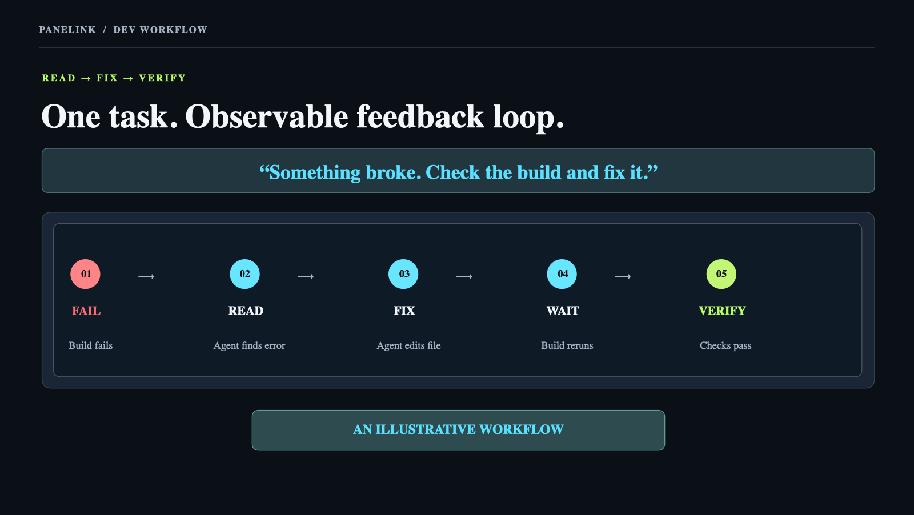
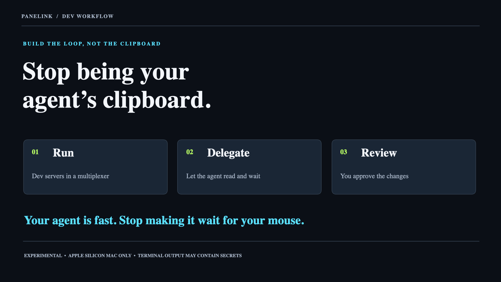

# Panelink

**Stop being your agent's clipboard.** Panelink keeps shells, development
servers, and agent terminals in a workspace that both you and your tools can
observe. When a build breaks, an agent can read the relevant pane, wait for
new output, and inspect the result instead of asking you to copy and paste a
stack trace. You still review the code change.

Panelink is an **experimental, local Rust terminal multiplexer for Apple Silicon
macOS**. It runs inside an existing terminal application; a background server
owns the processes and PTYs, so detaching or closing the terminal client does
not stop them. Apple Terminal is the first host baseline. The workspace model
is **project → workspace tabs → split panes**.

## The feedback loop

Imagine a build failing while an agent edits a project:

```text
Agent edits code → build reports an error → agent reads the build pane
                 → agent fixes the issue → build runs again
                 → agent checks the result → you review the diff
```

The relevant pieces are already available: persistent panes, bounded screen
reads, finite waits, and machine-readable CLI output. This is a workflow
example, not a promise that every diagnostic is captured or that a quiet
terminal means a successful build. Panelink can only read output that reaches
its managed terminal pane.



*Workflow illustration adapted from the presentation; not an application screenshot.*

## Get started

You need an Apple Silicon Mac, Apple's command-line tools (including
`/usr/bin/tic`), and Rust/Cargo. See [setup](docs/SETUP.md) for prerequisites
and troubleshooting. From this checkout:

```sh
cargo build --locked
mkdir -p "$HOME/.local/bin"
ln -sfn "$PWD/bin/panelink" "$HOME/.local/bin/panelink"
panelink
```

Make sure `~/.local/bin` is on your `PATH`. The development launcher runs this
checkout's **already-built** `target/debug/panelink`; it does not rebuild on
launch. The first interactive run opens a shell workspace, and later runs
reattach. If no tabs are visible, the client offers **New tab** or **Detach**
without starting a process.

Press **Ctrl-X** to detach and leave processes running. `panelink stop` ends
the **Default/Main** workspace and its processes. Closing a pane or tab also
ends its processes after confirmation; do not confuse Close with Detach.

### Everyday controls

| Task | In the terminal client |
| --- | --- |
| Discover actions | Click a pane's **Menu**, right-click it, or press **Ctrl-B**, then `s` |
| Split into a fresh shell | Choose Left, Right, Up, or Down from the pane menu; or **Ctrl-B**, then `l`, `r`, `u`, or `d` |
| Navigate panes | **Ctrl-B**, then arrows, Tab, or `o`; Esc leaves navigation mode |
| Create or switch tabs | Click `+`, or use **Ctrl-B** then `+`; **Ctrl-B** then `n`/`p` moves between tabs |
| Find tabs / see help | Click `≡` for **All tabs** or **Keys & help**; **Ctrl-B** then `w` or `?` |
| Scroll retained output | Wheel, right-margin scrollbar, or **Ctrl-B** then PageUp/PageDown; **Back to live** returns to current output |
| Copy visible text | Drag to select, or use **Ctrl-B** then `c` for keyboard copy mode |
| Zoom / swap / resize | **Ctrl-B** then `z`, `m`, or `e`; dividers can also be dragged |
| End a pane | Click its `x`, or **Ctrl-B** then `x`; confirm **Close** |
| Leave processes running | **Ctrl-X**, or **Detach** in the `≡` menu |

`Ctrl-B` uses the **Control** key, not Command. Controls activate when you
release inside the same button; dragging away or pressing Escape cancels. A
tab's `x` is separate from selecting it. Select an inactive tab before
closing it. The current source supports up to **four panes per workspace** and
**eight tabs per project**. See [interactive controls](.agents/skills/panelink/references/interactive.md)
for the full key and pointer behavior.

## Let an agent inspect another process

Run a build, test watcher, development server, or ordinary process in a
Panelink pane. From an authorized agent or another shell, inspect the
**Default/Main** workspace:

```sh
panelink pane list --json
panelink pane read 2 --bottom --lines 50 --json
panelink wait 2 --change --timeout 30 --json
panelink pane read 2 --bottom --lines 50 --json
```

Replace `2` with the pane you identified using `pane list`; pane numbers are
spatial and can change. `--change` observes a screen revision, **not** build
success. To wait for a known message, use:

```sh
panelink wait 2 --text 'YOUR_MARKER' --timeout 30 --json
```

Then inspect the actual output. A finite wait can time out or report a stale
target; rediscover the pane before taking another action.

To launch a separate process in a new split of a **running Default/Main**
workspace, the CLI also supports explicit child arguments and working directory:

```sh
panelink pane run --pane 1 --direction right --cwd /absolute/project --json -- /bin/zsh -i
```

Run your project's command in the new shell. A successful launch means the
shell was started, not that your task is ready or complete. Read the returned
target and subsequent output. The pane CLI does **not** silently follow
whichever project tab is active: `pane`, `wait`, `events`, `agent`, and legacy
`history` commands address Default/Main. For other tabs use the workspace
commands or a matching low-level routed endpoint; see the
[CLI workflows](.agents/skills/panelink/references/cli.md).

Agent input is deliberate. `panelink pane submit N 'text' --json` sends one
printable text submission plus Enter using short-lived input ownership. Check
its delivery result and the child's response; `Applied` confirms a PTY write,
not application acceptance or task completion. Do not resend uncertain input.
`panelink agent list|get|read|prompt|wait` additionally offers conservative
foreground Codex/OpenCode observations when **both** client and server support
the negotiated capability. Wrapper processes may not be recognized, and a
screen-derived state is not a provider conversation identity. See the
[agent usage guide](.agents/skills/panelink/SKILL.md) for targeting, ownership,
permissions, and recovery rules.



*Presentation artwork, not a product screenshot. Panelink provides panes and
read/wait commands; your agent environment handles delegation, and you review
the changes.*

## Workspaces, saved state, and recovery

Use `panelink workspace list` to discover project/tab IDs. The interactive
client can create, rename, switch, and close workspace tabs; each tab has its
own server, panes, and history. `panelink workspace open PROJECT_ID TAB_ID`
opens an explicit tab. `panelink workspace tab close PROJECT_ID TAB_ID`
**stops** that tab's processes. Projects are named groups; automatic
project-root discovery is not implemented.

Panelink saves bounded normal scrollback and latest visible screen checkpoints,
plus layout snapshots, in a private state directory at
`~/Library/Application Support/Panelink` (override with `PANELINK_HOME`).
Saved terminal data can contain secrets printed by programs even though
control sequences are sanitized. Useful read-only commands include:

```sh
panelink history list
panelink history show TARGET
panelink history search TARGET 'error'
panelink layout show
panelink recovery view
```

Use the five-number ID returned by `history list` for `TARGET`. History is
bounded to **1,024 normal scrollback rows / 8 MiB per session**, and captures
can lag live output. Saved rows, screen checkpoints, layout, and provider
conversations are different things: none restores a running process or replays
terminal input. `panelink recovery relaunch` explicitly starts **fresh shells**
from a saved layout; it does not resume an agent conversation. The opt-in
OpenCode bridge has narrower, explicit identity/prepare/resume rules described
in the [provider recovery guide](docs/progress/P4-MANUAL-RECOVERY.md).

## Project status and boundaries

Panelink is a working prototype, not a finished release. Source and automated
tests cover the multipane runtime, UI controls, agent-facing CLI, and bounded
saved state. Separate acceptance remains open for the full Apple Terminal
four-pane workflow, real clipboard/touch behavior, representative provider
usage, physical-reboot recovery, and performance targets. Do not infer these
from a passing build or a recorded demo. The [roadmap](ROADMAP.md) and
[current handoff](docs/progress/SESSION.md) distinguish delivered slices from
unverified gates.

The core is local and user-level. Access to the local control socket and
private caller-context storage is required for agent commands; the current
same-user boundary does not isolate one local agent from another. No hosted
binary, notarized release, or firm security approval is claimed. Panelink's
original application code is **intended** for MIT licensing; see
[third-party notices](THIRD_PARTY_NOTICES.md) and the
[security review packet](docs/SECURITY-REVIEW.md).

## Develop and learn more

```sh
python3 scripts/verify_non_ui.py
```

The verifier checks Rust tests, formatting, strict Clippy, build, component
fingerprints, Python tests, and documentation; ignored or environment-blocked
checks are not acceptance passes. See [CI](docs/CI.md),
[setup](docs/SETUP.md), and the [local alpha release procedure](docs/RELEASE.md).
For design details, see the [specification](docs/SPEC.md),
[product discovery](docs/PANELINK-DISCOVERY.md), and
[implementation roadmap](ROADMAP.md). `panelink --help`,
`panelink build-info --json`, and `panelink server-info --json` identify the
selected client and (when available) the separately running server; rebuilding
the client does not replace an attached client or restart its server.
