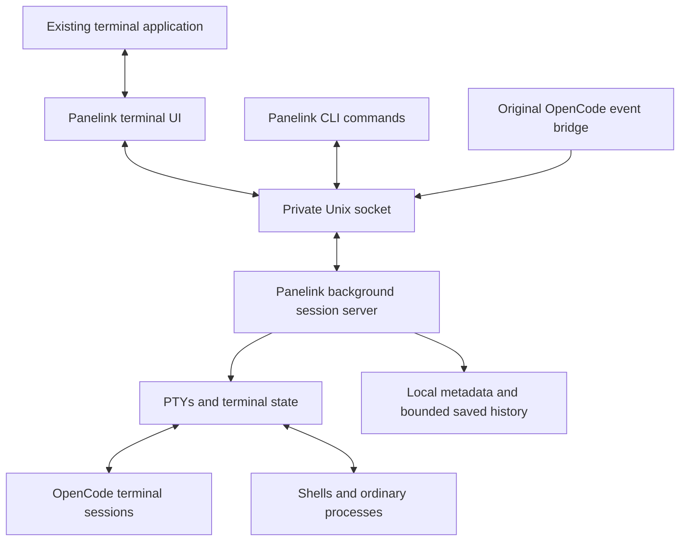

# Panelink: terminal workspace runtime research

Updated: 2026-10-17, including the user's security audit objective.

Panelink runs **inside existing terminal applications**, like tmux or Herdr. It provides workspaces for OpenCode and ordinary processes. The initial desktop GUI hypothesis is superseded; it is preserved only as [historical research](archive/2026-10-16-DESKTOP-OPTIONS.md).

This document contains engineering recommendations. Confirmed user decisions are recorded in [discovery](PANELINK-DISCOVERY.md); [SPEC.md](SPEC.md) is the working implementation specification. The dependency-free foundation is now implemented and verified; see [ROADMAP.md](../ROADMAP.md). No PTY/terminal compatibility or representative performance benchmark exists yet.

## Recommended architecture

Use one Rust executable with client and background-server modes. The server owns PTYs, child supervision, terminal state, workspace metadata, and saved history. A client draws the workspace UI in whichever compatible terminal the user opens. Clients can detach without ending server-owned processes.

The host terminal renders fonts and handles its own window. Panelink composes terminal cells, menus, panes, and workspaces. Its internal terminal engine interprets the programs running inside each pane so output stays within that pane and reattachment can reconstruct the live screen.

This model avoids a desktop UI toolchain and a separate browser runtime. It still requires correct terminal emulation, input encoding, mouse routing, resize handling, selection, and lifecycle control. Those are the hardest integration risks and should be the first prototype.

## Performance and dependency balance

Dependency decision status: open. The user has clarified that firm security audit acceptance is the main concern. These candidates have not been accepted, installed, or audited as a complete dependency tree. Obtain the applicable review criteria before finalizing them.

The user wants high performance, manageable build sessions, and dependencies only when established components save substantial implementation effort. Recommend evaluating this small set:

| Component | Recommendation | Why it earns consideration |
| --- | --- | --- |
| Terminal interface | [Ratatui](https://ratatui.rs/), MIT | Layout, menus, widgets, and buffered screen drawing save extensive UI work. Panelink's pane composition and interactions remain original. |
| Host input/output | [Crossterm](https://github.com/crossterm-rs/crossterm), MIT | Raw mode, keyboard events, mouse input, resize, and terminal cleanup avoid writing another host-terminal I/O layer. |
| Pane emulation | [`alacritty_terminal`](https://docs.rs/alacritty_terminal/latest/alacritty_terminal/), Apache-2.0 | Established terminal state/grid implementation; rewriting terminal compatibility would be a large project by itself. No Alacritty desktop renderer is required. |
| PTY ownership | Evaluate Alacritty's existing [TTY API](https://docs.rs/alacritty_terminal/latest/alacritty_terminal/tty/index.html) first | It may meet the macOS process supervision requirements without an additional PTY dependency. Prove the API outside Alacritty before committing. |
| PTY fallback | [`portable-pty`](https://docs.rs/portable-pty/latest/portable_pty/), MIT | Add only if the selected engine's PTY integration materially complicates independent server ownership. Use one owner, never two overlapping PTY loops. |
| Typed persistence/protocol | Serde + serde_json, subject to dependency review | Save effort and correctness risk in serialization. Do not handwrite a JSON parser merely to reduce the direct crate count. |
| Sockets, threads, files | Rust standard library initially | Unix sockets, bounded channels, threads, filesystem operations, and process launching may suffice at the target concurrency. Add an async runtime only when demonstrated needs justify it. |
| Memory allocator | Rust's default system allocator initially; benchmark mimalloc later | The ms-rust skill recommends mimalloc based on allocation-heavy hot-path benchmarks. Panelink has no profile yet, and agent child processes may dominate resource use. The allocator is mature, but a global swap adds native build code and has no established Panelink-specific benefit. |

Ratatui and Crossterm expose [MIT notices](https://raw.githubusercontent.com/ratatui/ratatui/main/LICENSE), [MIT notices](https://raw.githubusercontent.com/crossterm-rs/crossterm/master/LICENSE); Alacritty's [manifest](https://raw.githubusercontent.com/alacritty/alacritty/master/alacritty_terminal/Cargo.toml) specifies Apache-2.0. Review the exact pinned versions and full transitive dependency graph before adopting them. Maintenance evidence and project use are selection signals, not a guarantee that any dependency is fully trustworthy.

Avoid a separate async runtime, HTTP client, database binding, configuration format library, plugin framework, or general-purpose clipboard crate until the feature needs them. Do not bundle OpenCode or Tabnine in the initial release: use the user's installed executables and existing authentication. The skill's mimalloc recommendation is deferred until representative profiling shows a useful gain over the system allocator.

One proposed storage approach is atomically replaced versioned JSON metadata plus bounded history segments, with one server writer. Evaluate SQLite only if cross-record recovery or history querying becomes materially simpler with it. Atomic rename alone is not a complete durability protocol: the spec must cover sync ordering, partial history records, metadata/history generations, rotation, and recovery.

Use a small Cargo workspace, limited feature flags, incremental development builds, and release builds at milestones. Measure cold and incremental builds on the actual machine before promising times. A dependency count alone does not predict compile time or maintenance burden.

### What is essential versus replaceable

The strongest reuse case is a proven terminal engine: full-screen programs require cursor/mode/screen handling regardless of which host terminal displays Panelink. A Rust library dependency does not require installing the corresponding desktop terminal app. Host input parsing is another strong reuse candidate. Ratatui's UI conveniences are more replaceable, although writing buffered drawing and interaction primitives would add work. Serde is serialization tooling, not the workspace architecture.

For each candidate, the implementation decision should record the exact required APIs, alternative using macOS/Rust standard facilities, full transitive graph and licenses, maintenance evidence, enabled features, and measured build/runtime impact. Do not label a dependency fully trusted merely because it is popular. No measurements or complete audit have yet been performed.

### Security audit acceptance as a selection criterion

Recommendation: optimize for a small, explainable, versioned dependency tree and documented behavior. Handwriting terminal emulation moves review responsibility into Panelink's own code; reducing the dependency count alone does not establish lower risk or approval eligibility.

Prepare evidence tied to each release: source commit, compiler/toolchain, lockfile, runtime/build dependency inventory, licenses, advisory findings and disposition, build procedure, artifact hashes, signing information where applicable, and vulnerability response ownership. Include build scripts, procedural macros, native libraries, and downloaded build inputs in the review scope. Do not represent candidate-library popularity as security certification.

NIST's [Secure Software Development Framework](https://csrc.nist.gov/projects/ssdf) provides a useful reference for secure development, component provenance, protecting releases, and responding to vulnerabilities. It is not the firm's checklist and does not confer audit approval.

Cargo supports [vendored dependency sources](https://doc.rust-lang.org/cargo/commands/cargo-vendor.html) and [locked/offline build modes](https://doc.rust-lang.org/cargo/commands/cargo-build.html). These can support an approved internal build process. Toolchains, SDKs, and build-script inputs must also be available; a lockfile or vendored crates alone do not establish byte-for-byte reproducibility or make code safe. Vendored libraries, if selected, remain clearly identified third-party source with their notices.

Propose no direct internet access or TCP listener in Panelink's initial core, no telemetry or automatic downloads, and user-level execution. The launched OpenCode/Tabnine/shell processes retain their own capabilities and network behavior. Panelink is not their security sandbox. Document executable discovery, environment inheritance, local socket authority, integration activation, terminal control-sequence handling, and credential ownership.

Saved history can contain sensitive output, and automatic copying writes to a system clipboard that other software or OS services may access. Keep the requested personal features, with explicit settings for disabling capture, bounding/deleting retained data, disabling selection copying, and controlling agent bridges. Any firm-managed enforcement mechanism needs an agreed platform deployment model; a user-editable config file is not tamper-resistant enforcement. Do not promise complete secret removal through heuristic redaction.

The next decision should be the firm's acceptable dependency and execution policy, including whether OpenCode itself is approved. Choosing tmux or eliminating a Rust crate does not bypass those requirements.

### Alternative: tmux supplies the multiplexer

Panelink could instead be original Rust orchestration around an installed tmux backend. The official [tmux manual](https://man.openbsd.org/tmux.1) documents menus, mouse handling, copy mode, and command execution; its [control mode](https://github.com/tmux/tmux/wiki/Control-Mode) supports external clients. A design using tmux's own UI could reuse its panes and persistence while Panelink adds project/OpenCode workflow logic and original configuration.

This is a different architecture: tmux becomes a required external program and owns sessions. Deep custom sidebar behavior and interaction are constrained by tmux's UI model. A wholly custom control-mode frontend would still need to interpret/render pane output; control mode alone is not a ready-made custom UI. Reusing installed tmux does not import its source code, but it does make Panelink depend on another runtime. Consider this only if the user prefers that tradeoff; no switch has been selected.

## Why a terminal engine is still needed

Running inside a terminal app does not remove the need to interpret pane output. Editors and agents move cursors, switch alternate screens, set modes, and query their terminal. Panelink must maintain separate state for every pane and answer relevant terminal queries correctly.

The server should own authoritative emulator state. Send versioned viewport snapshots/deltas and terminal mode information to the client, not arbitrary upstream internal types. On reconnect use a consistent snapshot plus sequenced later updates. A plain output tail cannot reliably reconstruct a full-screen program.

Keep blocking PTY work and filesystem flushes away from the client drawing loop. Continue draining and parsing every pane while detached. Bound history and transport queues; drop superseded display updates with resync, never arbitrary bytes needed by the emulator. Draw only when dirty and cap redraws during output bursts. Hidden panes still need their state updated, without continuous full UI redraws.

The target workload is 5–10 agent sessions plus ordinary processes. Actual latency, CPU, memory, and build budgets must come from a prototype on specified hardware; agent process memory must be reported separately from Panelink overhead.

## OpenCode first

Use OpenCode's existing terminal UI in a managed PTY. A launcher is a saved executable/argument list and working directory, such as “OpenCode in this project” or “start the dev server.” It is a convenience action, not a different agent implementation.

OpenCode documents [plugin lifecycle and permission events](https://docs.opencode.ai/docs/plugins/). Evaluate a small original bridge with per-launch or project-scoped activation, avoiding silent global configuration changes. It may use JavaScript/TypeScript within OpenCode's existing runtime. Rich status is optional; reliable provider-session identity is an early requirement for managed recovery. Generic terminal operation remains possible if integration is unavailable, but its recovery capability must be reduced visibly.

Use explicit session identity to distinguish top-level sessions from OpenCode subagents. Missing events imply unknown status; silence does not imply completion. Preserve OpenCode's own in-terminal approvals. Rich chat and a universal approval UI are outside the current direction.

The documented session events do not by themselves prove that an adapter can observe every selected-session change in the interactive TUI. The first feasibility gate must establish that ability, durable mapping acknowledgment, and specific-ID recovery with two concurrent agents in one project. The [spec's identity contract](SPEC.md#durable-provider-session-identity) defines pending/verified/stale states and explicit last-confirmed/manual fallback. Do not promise guaranteed current-at-crash identity from an optional bridge or infer it from the latest active session.

The documented [server API](https://docs.opencode.ai/docs/server/) exposes HTTP and server-sent events, while the [CLI](https://docs.opencode.ai/docs/cli/) supports explicit session resume. These are alternatives for status/recovery integration if the bridge proves unsuitable. Do not adopt HTTP and an extra SDK solely because they exist. Pin a supported OpenCode version before finalizing the adapter contract.

## Tabnine feasibility

Tabnine now documents a [terminal CLI](https://www.tabnine.com/platform-cli/) and [macOS installation](https://docs.tabnine.com/main/getting-started/tabnine-cli/getting-started/installation). Basic operation inside a PTY is a plausible optional feature. Its documentation lists host/account/team prerequisites, so entitlement and installation must be checked on the user's setup.

This research has not established a supported status/permission/resume API for Panelink's use. Do not promise parity with OpenCode. Launch it as an ordinary CLI first, label activity unknown where necessary, and add richer behavior only after documented integration and compatibility checks.

Neither `opencode` nor `tabnine` was found on the shell PATH during this session. That is not proof they are absent from every environment. No agents have been installed or configured.

## Herdr lifetime behavior

Herdr's [persistence documentation](https://herdr.dev/docs/persistence-remote/) says it keeps panes in a background server, detaches with Ctrl+B then Q, reconnects when invoked again, and stops the default session with an explicit server-stop command. On macOS/Linux its server ignores SIGHUP.

Recommend the same user-visible lifetime model for Panelink: closing or quitting the host terminal disconnects the client while a healthy independently launched Panelink server keeps its processes. Panelink cannot intercept the host terminal app's Cmd-Q as its own global action. Server independence must be demonstrated under real host termination.

After reboot, restore retained layouts/history and offer OpenCode resume from an acknowledged saved mapping, labeled by verification time; uncertain identity uses explicit manual selection. Saved history means retained normal scrollback and the last committed normal/alternate screen checkpoints, not all overwritten screen content or a complete conversation archive. See the [history contract](SPEC.md#meaning-of-saved-history). Restarting a conversation does not resurrect old process memory. Never automatically rerun arbitrary saved shell commands. Sleep pauses ordinary local execution; this is not an always-running remote service.

## Right-click and selection

Herdr documents [mouse interaction, right-click menus, and drag selection copying](https://herdr.dev/docs/keyboard/). Panelink can implement its own original menus and copy behavior through host mouse reporting. Crossterm documents [keyboard, mouse, paste, and resize events](https://docs.rs/crossterm/latest/crossterm/event/index.html).

Proposed behavior:

- Right-click opens a menu drawn inside Panelink: split, new shell, start OpenCode, rename, zoom, move, copy/paste, and close according to context.
- Dragging text creates a pane-aware selection. On release, copy the selected text to the macOS clipboard without requiring Cmd-C.
- Use macOS `pbcopy`/`pbpaste` from the attached local client as the first clipboard implementation, passing text through stdin rather than shell interpolation. Clipboard work must not block the drawing loop.
- Treat those user actions separately from child-emitted clipboard requests: deny programmatic clipboard reads and writes in the first release, including while detached. No request is queued for later attachment. The [clipboard contract](SPEC.md#clipboard-authority-and-terminal-requests) specifies the denial and reply behavior.
- Keep selections within pane content; handle wide characters, wrapping, empty cells, and continuing output consistently. Offer keyboard copy mode and a shortcut for every essential menu operation.
- Decide deliberately when Panelink consumes a mouse gesture and when an inner program receives it. Menus and pane chrome belong to Panelink. A host terminal may intercept right-click before Panelink receives it, so document per-host setup and preserve keyboard fallbacks.

“Works with any terminal app” is a compatibility goal for modern terminals with the required control protocols. Exact mouse, clipboard, colors, modified keys, and Unicode behavior vary by terminal. Define a tested host matrix and a degraded keyboard-only mode instead of promising identical behavior in every terminal ever made.

## Scope and first proof

First prove: one OpenCode-compatible PTY, the server's independent lifetime, safe lost-ack retries and input nonreplay, durable provider identity and session switching, explicit launch environments, full-screen checkpoints/reconnect, clipboard denial, and keyboard/paste/resize. Then add workspaces, tabs/splits, full history/search, richer status, pane selection, and context menus in vertical slices. The [spec](SPEC.md) contains acceptance scenarios for each reviewed failure case.

Ratatui is not itself a terminal emulator, and the terminal engine is not a complete multiplexer. Their integration remains original Panelink work. Do not copy Herdr source, port its implementation, or import its UI assets.

The user wants personal use first, later public MIT release, with a private source repository during development. On 2026-10-17, the user confirmed [sahillamba/panelink](https://github.com/sahillamba/panelink) as the private GitHub repository and requested an initial commit of the current files. Local Git initialization and remote creation succeeded; GitHub CLI authentication was verified outside the network-restricted sandbox. Git history is the source of truth for commits and pushes.
