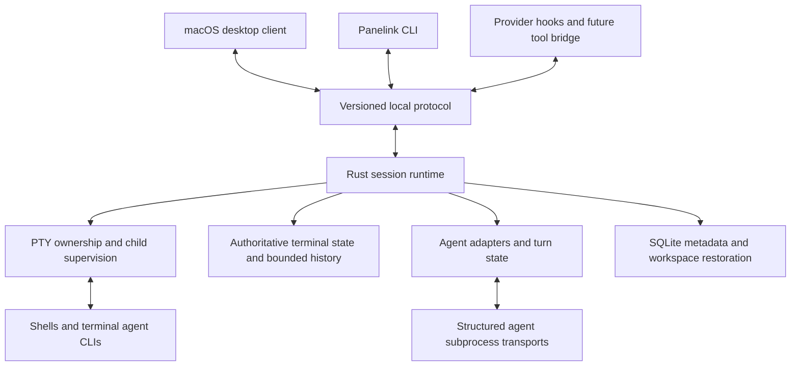

# Archived research: desktop UI options

Research date: 2026-10-16.

Status: superseded. The user clarified that Panelink must run inside existing terminal applications. The desktop UI direction below is an earlier hypothesis and must not guide implementation. Read the [current research](../PANELINK-RESEARCH.md) and [current discovery decisions](../PANELINK-DISCOVERY.md). No upstream implementation code was imported and no prototype, performance benchmark, or compatibility test was run during this earlier pass.

## 1. Recommendation

Build an independent Rust session runtime with a thin desktop client. The runtime owns shells, PTYs, terminal state, and agent processes; closing the desktop client detaches from that runtime. Give the desktop app, a small CLI, and future agent integrations one versioned control surface.

For a predominantly Rust application, the leading UI candidate is **GPUI with `alacritty_terminal` and an original terminal renderer**. For the fastest route to a usable first release, the leading alternative is **Tauri 2 with xterm.js and a Rust runtime**. The latter includes a web frontend. Choose after the user clarifies the Rust requirement and a focused integration prototype establishes feasibility.

This is an engineering recommendation, not a benchmark result. A framework cannot determine the right product scope, and published documentation does not prove Panelink's input latency, accessibility, memory use, or reconnect correctness.

The central architectural commitment should be runtime ownership and protocol boundaries. Keep the GUI choice replaceable without promising that swapping renderers will be cheap.

## 2. What the reference products establish

| Reference | Relevant documented behavior | Lesson for an original implementation |
| --- | --- | --- |
| [tmux control mode](https://github.com/tmux/tmux/wiki/Control-Mode) | External clients control sessions and receive pane output and lifecycle notifications. | A durable session service and a GUI are separate concerns. An optional tmux backend is possible. |
| [Herdr persistence](https://herdr.dev/docs/persistence-remote/) and [session restore](https://herdr.dev/docs/session-state/) | A background server keeps panes alive while clients detach. Server restart and live reattachment have different guarantees. | Specify exactly which failure boundaries Panelink survives. |
| [Herdr socket API](https://herdr.dev/docs/socket-api/) | CLI wrappers and automation share a local control interface. | Human, script, and agent actions should use the same domain operations. |
| [WezTerm multiplexing](https://github.com/wezterm/wezterm/blob/main/docs/multiplexing.md) | Local and remote multiplexing domains can be attached to a native GUI. | Terminal session ownership can live outside a native terminal window. |
| [Zellij resurrection](https://zellij.dev/documentation/session-resurrection) | Saved layouts and commands can reconstruct a workspace; commands may need explicit user action before restarting. | Workspace restoration must distinguish rerunning commands from preserving running processes. |
| [cmux](https://github.com/manaflow-ai/cmux) | A macOS GUI combines panes, workspaces, agent notifications, and automation. | Identify Panelink's specific advantage before expanding into a general development environment. |

These are behavior references. Panelink should define its own domain model, UX, wire protocol, and implementation from its requirements.

## 3. UI and terminal stack comparison

| Candidate | Verified facts | Assessment for Panelink |
| --- | --- | --- |
| GPUI | The [crate manifest](https://raw.githubusercontent.com/zed-industries/zed/main/crates/gpui/Cargo.toml) declares Apache-2.0. [Published documentation](https://docs.rs/crate/gpui/latest) describes a GPU UI framework with a changing pre-1.0 API. [InputHandler](https://docs.rs/gpui/latest/gpui/trait.InputHandler.html) provides composition interfaces. | Leading Rust UI candidate. Requires original terminal drawing, selection, keyboard routing, input composition, and accessibility integration. GPU rendering does not mean AppKit-native controls. Pin the chosen version. |
| Tauri 2 + xterm.js | [Tauri](https://github.com/tauri-apps/tauri) combines Rust with a web frontend and uses WKWebView on macOS. [xterm.js](https://github.com/xtermjs/xterm.js) is MIT, with Unicode/IME, terminal interaction, screen reader mode, and optional GPU rendering. | Leading delivery-speed candidate. Terminal frontend behavior already exists, but the daemon bridge, reconnect strategy, and real WKWebView performance need proof. TypeScript/JavaScript is part of the product. |
| Iced | [Iced's manifest](https://raw.githubusercontent.com/iced-rs/iced/master/Cargo.toml) declares MIT. Its [accessibility implementation issue](https://github.com/iced-rs/iced/issues/552) remains an important maturity signal. | Credible Rust alternative; less compelling than the finalists for this particular terminal product. Recheck accessibility against the exact version before choosing. |
| objc2 + AppKit | [objc2's license inventory](https://raw.githubusercontent.com/madsmtm/objc2/main/LICENSE.md) distinguishes crate and example licenses. [AppKit bindings](https://docs.rs/objc2-app-kit/latest/objc2_app_kit/) expose native platform APIs. | Direct native platform control, with substantial main-thread, ownership, rendering, and input work. Consider if AppKit fidelity dominates. A small Swift/AppKit shell around Rust is another option if the user accepts mixed languages. |

### Terminal engine and PTY choices

- **`alacritty_terminal`:** a published Apache-2.0 Rust engine with terminal state and grid APIs; it does not supply the Alacritty GUI renderer. Leading engine candidate for GPUI. See its [manifest](https://raw.githubusercontent.com/alacritty/alacritty/master/alacritty_terminal/Cargo.toml) and [API](https://docs.rs/alacritty_terminal/latest/alacritty_terminal/).
- **`portable-pty`:** an MIT PTY abstraction for spawning, resizing, and communicating with child processes. It supplies neither terminal emulation nor persistence. Use either this layer or an engine's PTY facilities as the owner, with no duplicate ownership. See the [manifest](https://raw.githubusercontent.com/wezterm/wezterm/main/pty/Cargo.toml) and [API](https://docs.rs/portable-pty/latest/portable_pty/).
- **libghostty-vt:** a credible MIT terminal engine alternative. The official [Ghostling explanation](https://github.com/ghostty-org/ghostling) explicitly separates terminal state from renderer drawing and windowing. [Ghostty 1.3 release notes](https://ghostty.org/docs/install/release-notes/1-3-0) describe the library's release maturity. A Rust consumer adds C/Zig FFI and versioning work. This public library does not automatically provide Ghostty's native macOS renderer.
- **`vt100`:** its [screen API](https://docs.rs/vt100/latest/vt100/struct.Screen.html) can emit formatted terminal state and differences. Potentially useful for a constrained snapshot experiment, but completeness for modern agents and terminal protocols must be established before adopting it as the core.

### Important license boundary

GPUI's Apache-2.0 license does not apply to every Zed crate. Zed's [terminal crate manifest](https://raw.githubusercontent.com/zed-industries/zed/main/crates/terminal/Cargo.toml) declares GPL-3.0-or-later. Using GPUI as a dependency and implementing Panelink's own terminal integration is a different dependency choice from taking Zed's terminal component.

## 4. Proposed runtime architecture

The following names and boundaries are proposals, not code that exists.

### Domain boundaries

- `panelink-core`: typed IDs, workspace structure, layout tree, commands, events, and state transitions. No GUI dependencies.
- `panelink-runtime`: user session process, PTY ownership, child supervision, event sequencing, and background lifetime. Tokio for async control, with blocking PTY work isolated from async executor threads.
- `panelink-protocol`: handshake, schemas, version negotiation, requests, responses, events, snapshots, and bounded transport framing.
- `panelink-terminal`: a narrow wrapper around the selected engine, including terminal state, scrollback, resize, and snapshot behavior. Avoid exposing upstream internal types in the public wire protocol.
- `panelink-agents`: provider adapters with explicit capability declarations. Initially one module can contain these adapters; do not create a plugin framework before it is needed.
- Desktop client and CLI: consumers of runtime operations. The GUI does not own PTY lifetime.

These can start as modules in a small Cargo workspace. Do not create separate services or crates solely to mirror this list. Tokio documents [dedicated resource ownership through message passing](https://tokio.rs/tokio/tutorial/channels); that is a useful pattern for per-session control.

Separate a **terminal session** from a **pane that views it**. Moving a pane or reopening a window should not create a replacement shell. Separately model an **agent conversation** and a **turn**; one long-lived agent process can handle many turns.

Suggested initial records: Workspace, LayoutNode, PaneView, TerminalSession, AgentSession, AgentTurn, PendingRequest, and EventCursor. Confirm hierarchy and naming with the user before formalizing schemas.

### Local protocol

Start with a per-user Unix domain socket, a private runtime directory, bounded frames, a handshake, and stable IDs. Prefer a straightforward typed JSON control protocol; carry high-volume terminal data in framed byte payloads if profiling supports that choice. Preserve non-UTF-8 output and incremental decode boundaries.

Assign monotonic sequence numbers within a clearly defined runtime generation. Reconnect combines a consistent snapshot with subsequent events; detect gaps and request a resync. Specify which client controls terminal size and interactive input if multiple viewers attach. The MVP can permit one interactive viewer per session.

Bound queues and history. A detached or slow GUI must not stop PTY draining. Parse all terminal bytes needed for authoritative state before dropping display history. Rate-limit metadata updates and coalesce drawing invalidations, not arbitrary terminal bytes.

### Reconnect is an early feasibility gate

An output log is not a terminal snapshot. A tail of text cannot reconstruct cursor positions, alternate screen buffers, styles, modes, hyperlinks, and scrollback reliably.

For GPUI, keep the authoritative engine in the runtime and design a serializable rendering snapshot/delta contract. The client still needs terminal input encoding and platform input behavior.

For xterm.js, resolve the engine boundary before promising faithful detach/reattach. xterm's [headless package and serialize addon](https://github.com/xtermjs/xterm.js) support a Node-based state keeper, which introduces another runtime. A Rust server engine producing snapshots for xterm introduces cross-engine compatibility work. Retaining full byte history with resize events can be a constrained prototype strategy, but it is not a bounded, permanent persistence solution. Select and document one approach after a prototype; do not silently lose screen state when history is truncated.

If using Tauri, its official [frontend communication guide](https://v2.tauri.app/develop/calling-frontend/) recommends channels for streaming; ordinary events are not designed for high throughput or low latency. Batch terminal output through the intended streaming path. Rendering should not force the whole pane layout to update on every output chunk.

## 5. Persistence guarantees

| Event | Proposed first-release behavior | Limit |
| --- | --- | --- |
| Window closes or client detaches | Session runtime and terminal processes remain alive. | Needs explicit detach semantics and a runtime with independent lifetime. |
| Desktop app crashes or is force quit | Reopen and attach to live sessions. | Applies only when the runtime remains healthy. |
| Runtime crashes | Restore saved workspace metadata and mark live processes/session state lost or uncertain. | Saving SQLite records does not preserve PTY ownership or arbitrary process state. |
| Mac sleeps | Reconnect on wake and reconcile state. | Local compute normally pauses during sleep; the app cannot promise local agents keep executing. |
| Logout, reboot, or power loss | Restore layout and offer supported agent conversation resume or explicit relaunch. | Processes are not preserved. Never rerun arbitrary shell commands automatically by default. |

Store transactional workspace metadata, settings, schema version, and supported provider session identifiers in SQLite. [SQLite transactions](https://www.sqlite.org/lang_transaction.html) allow multiple readers and one writer; one runtime-owned writer is a simple starting point. [WAL mode](https://www.sqlite.org/wal.html) has its own checkpoint and backup considerations. Terminal screen/history retention should have its own explicit bounds and privacy settings, rather than storing every byte forever in the metadata database.

Provider-native conversation resume is a provider capability, not a generic PTY feature. A stored PID is insufficient to identify a live managed session after restart.

## 6. Agent integration strategy

| Mode | Useful capabilities | Honest limits |
| --- | --- | --- |
| Generic CLI in a PTY | Run the user's installed CLI, show its own UI, send input, resize, interrupt, and supervise its process. | Terminal output and silence cannot establish successful task completion or a universal approval state. |
| CLI plus provider hooks | Correlated lifecycle and attention badges while retaining the CLI's UI. | Hook meanings and installation are provider-specific. Stale or missing events need an unknown state. |
| Structured provider adapter | Native turns, streamed events, approvals, cancellation, and supported resume. | Different transport and UX from a terminal pane. Version and capability support are explicit. |
| ACP adapter | Common client interface for compatible coding agents. | Support is negotiated; arbitrary CLIs do not become ACP agents automatically. |
| Optional MCP bridge | Expose selected Panelink operations as agent tools. | MCP does not replace process supervision or the agent conversation lifecycle. |

### Provider choices

**Codex:** the official [app-server documentation](https://developers.openai.com/codex/app-server/) describes bidirectional structured communication, stdio transport, thread/turn lifecycle, streaming, and approval requests. Prefer a Rust subprocess adapter using the installed supported binary for a deep integration. Pin supported protocol versions, generate or validate schemas from that version, and correlate approvals with request and turn IDs. Experimental transports should not become the MVP's local control dependency. Native chat support should not assume the same session can also be driven through its ordinary interactive CLI UI.

**Claude Code:** use official [hooks](https://code.claude.com/docs/en/hooks) for a lighter status integration. A Stop event means the main agent finished responding, which is different from all background work having finished. A permission notification is an attention signal, not permission to approve the action. The [Agent SDK overview](https://code.claude.com/docs/en/agent-sdk/overview) documents Python/TypeScript SDKs and other integration paths; native Rust SDK availability must not be assumed. Embedded product auth and subscription use need a current provider check before becoming promised features. Let the user's CLI own its credentials in terminal mode.

**ACP:** the [protocol overview](https://agentclientprotocol.com/protocol/overview) defines sessions, prompt updates, permission requests, cancellation, and capabilities. Its official [Rust SDK](https://github.com/agentclientprotocol/rust-sdk) is an optional implementation aid. Confirm exact agent implementations and supported protocol versions before listing compatibility.

**MCP:** the [official introduction](https://modelcontextprotocol.io/docs/getting-started/intro) describes tools, resources, and context integration. An eventual Panelink MCP surface should call the same authorized domain operations as the CLI.

Model process lifecycle separately from agent activity. Suggested process states are starting/running/exited/failed; suggested agent states are unknown/working/needs-input/turn-ended/error. Record the source, timestamp, and correlation identity of status observations. “Turn ended” does not imply the user's task succeeded.

Keep agent approvals in their own terminal UI until a structured adapter can faithfully represent and answer them. Avoid simulated yes/no keystrokes based on guessed screen text.

## 7. Git workspaces, automation, and scope

Git worktrees are a practical later feature for agents working on separate branches: see the official [git-worktree documentation](https://git-scm.com/docs/git-worktree.html). They separate working directories, not OS permissions or secrets. Define ownership, branch naming, reuse, dirty worktree handling, and removal behavior before automatic creation or cleanup.

Distinguish three product levels:

1. Launch and monitor independently controlled agent CLIs.
2. Offer structured conversations, status, and approval handling through adapters.
3. Delegate tasks among agents, schedule dependencies, review results, and merge work.

Recommendation: begin with level 1, prove one adapter from level 2, then specify level 3 as a separate phase if it is part of Panelink's purpose. Routing models and merging code introduce product policies beyond terminal multiplexing.

Likewise, opening `ssh` in a local pane is different from persistent remotely hosted sessions. Remote session guarantees need a runtime or compatible multiplexer on the remote host. Decide whether existing tmux attachment is a first-class requirement before excluding a tmux backend.

## 8. macOS integration and distribution

Recommend direct distribution of a signed and notarized application initially. Apple's [notarization requirements](https://developer.apple.com/documentation/security/notarizing-macos-software-before-distribution) include signing distributed executables and hardened runtime configuration. Packaging must include the runtime helper as well as the desktop executable.

The Mac App Store requires App Sandbox, and embedded command-line tools inherit relevant restrictions; see Apple's [App Sandbox guidance](https://developer.apple.com/documentation/security/protecting-user-data-with-app-sandbox). For a tool intended to execute ordinary user shells and developer tools, direct distribution avoids making sandbox compatibility an initial architecture constraint. This is a recommendation, not a claim that terminal apps can never ship through the Store.

Apple's [SMAppService](https://developer.apple.com/documentation/ServiceManagement/SMAppService) manages bundled login items and agents on macOS 13 and later. Evaluate a user-level helper if the product needs login/background service integration. Do not require a root daemon. Auto-launch after login does not restore processes that died at logout.

The native integration plan also needs shell/PATH discovery when launched from Finder, menu shortcuts, notifications, Dock/window behavior, fonts and Retina scaling, Option-key behavior, IME, and accessibility. Test these on the supported OS/hardware matrix before claiming parity with established terminals.

### Essential access boundaries

The local control socket can launch commands, so directory permissions, peer verification, and request authorization matter. Do not describe a same-user socket as a complete sandbox against arbitrary same-user processes. Scope optional agent tool access to the intended workspaces and operations.

Treat terminal output as terminal data, not HTML or executable UI code. Keep remote web content away from privileged terminal UI contexts. See [xterm's security guide](https://xtermjs.org/docs/guides/security/) and [Tauri security guidance](https://v2.tauri.app/security/). Provider credentials should remain in their own supported store; exclude raw credentials and sensitive terminal content from diagnostics by default.

## 9. Original code and MIT licensing

Confirmed user intent: original application implementation, no direct copying from other projects, and MIT licensing for Panelink's own code.

Proposed interpretation requiring user confirmation: using published permissive dependencies is allowed, while importing/forking/porting competitors' implementation code is excluded. If all third-party libraries are excluded, the architecture, effort, and terminal compatibility goals change substantially.

The [MIT license](https://opensource.org/license/mit) requires preservation of its notice in covered distributions. [Apache 2.0](https://spdx.org/licenses/Apache-2.0.html) dependencies retain their own conditions and notices; Panelink's MIT declaration does not relicense them. Review exact dependency versions, bundled helper binaries, fonts, icons, and transitive licenses before release.

GPUI and Alacritty's manifests declare Apache-2.0; portable-pty and xterm.js declare MIT. These are viable candidates for an MIT application with appropriate third-party notices. This research is not a complete dependency audit because no dependency graph exists yet. [cargo-deny](https://github.com/EmbarkStudios/cargo-deny/blob/main/README.md) can enforce an explicit dependency license policy once that graph exists.

cmux's [current license](https://raw.githubusercontent.com/manaflow-ai/cmux/main/LICENSE) is GPL-3.0-or-later; it is a product behavior reference here. Herdr's [official site](https://herdr.dev/) states Apache 2.0, and [tmux's COPYING](https://raw.githubusercontent.com/tmux/tmux/master/COPYING) describes its permissive notices. User instructions about originality still apply regardless of permissive upstream licenses.

## 10. Recommended build sequence

This is a proposed sequence for the eventual specification. It is not authorization to implement before product discovery is complete.

| Stage | Deliverable | Exit evidence to require |
| --- | --- | --- |
| 0. Product decisions | Agreed scope, primary workflow, architecture constraints, supported Macs, originality policy. | Confirmed answers recorded with unresolved choices visible. |
| 1. Terminal feasibility | One terminal pane in the selected UI candidate and an independent Rust PTY runtime. | Correct interactive input, resize, Unicode, and reconnect after client loss. Resolve snapshot approach here. |
| 2. Runtime foundation | Versioned IPC, supervision, bounded terminal state/history, minimal CLI, metadata schema. | Detach/reattach works; output while detached does not stall or corrupt state; protocol mismatch is understandable. |
| 3. Workspace experience | Splits, tabs/workspaces, focus, shortcuts, titles, search, themes, explicit stop behavior. | A complete daily workflow can be performed with keyboard and mouse. |
| 4. Agent visibility | Chosen CLI launchers, correlated hook status, notifications, unknown/error states. | Real installed agent versions produce truthful status without false completion claims. |
| 5. Structured integration | One explicitly selected adapter, if required. | Turn lifecycle, cancellation, approvals, provider errors, and supported resume work. |
| 6. Release | Signed app/helper, notarization, notices, install/update/uninstall behavior. | Clean-machine installation and upgrade preserve the documented session guarantees. |
| Later | Remote runtime, worktree automation, scheduling, delegation, plugins, collaboration. | Separate scoped requirements and acceptance criteria. |

Prototype evaluation should cover normal shells, vim/less/htop or equivalents, agent TUIs, large output, rapid resize, split focus, bracketed paste, Unicode/emoji, IME, VoiceOver, and reconnect from alternate-screen apps. Ask the user for realistic concurrency and hardware before assigning numeric performance budgets. These are proposed checks; none have been run.

For agent-assisted implementation, use small vertical slices with one observable behavior each. Each task should name owned files/modules, input/output contracts, failure behavior, acceptance checks, dependency decisions, and required handoff updates. Parallel work becomes useful after shared protocols and ownership are stable; runtime lifetime and terminal input deserve focused review.

## 11. What remains uncertain

- Whether Rust is required throughout the UI or only in the runtime.
- Whether third-party libraries are allowed under the originality requirement.
- Panelink's primary user journey and distinction from existing terminal workspaces.
- The target agent list, and whether terminal visibility or autonomous orchestration is the first goal.
- The selected UI's actual compatibility/performance on the user's Macs.
- The reconnect snapshot approach, especially if using different terminal engines server/client.
- Existing tmux adoption, remote sessions, worktree automation, and provider auth requirements.
- Supported macOS versions, Intel support, release channel, and quality budgets.

This historical desktop direction is superseded. Use the [current product discovery](../PANELINK-DISCOVERY.md) and [current specification](../SPEC.md) for the terminal-based product.
